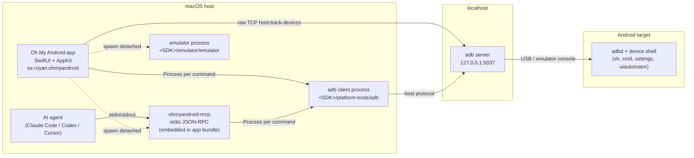

# 00 — Architecture overview

Evidence base: `9f37391`. All claims cite `path:line`. No mirroring, no adb library, no database.

## Purpose

A macOS menu-bar app (and a bundled MCP server) that drives **one** connected Android target through
`platform-tools/adb`, so a developer can toggle test conditions (dark mode, font scale, locale/RTL,
TalkBack, animations, network, GPS, battery), inspect layout in **dp**, read debug-only app data, and
let an AI agent do the same. `README.md:5-7`, `Sources/Features/FeatureCatalog.swift:5-71`.

## Capability list (as registered)

| Category | Features | Evidence |
|---|---|---|
| Appearance | Dark mode, Font size, Display size, Language/Locale, Rotate | `Sources/Features/FeatureCatalog.swift:7-12`, `Sources/Features/DisplayFeatures.swift:3-100` |
| App | Restart, Clear data, Deep link, Data inspector, Install APK, App info, Reset permissions, Force stop, Uninstall | `Sources/Features/FeatureCatalog.swift:14-24`, `Sources/Features/AppFeatures.swift:56-98` |
| Capture | Screenshot (PNG → Desktop), Screen record (emulator console), Quality, Open captures folder | `Sources/Features/FeatureCatalog.swift:26-30`, `Sources/Features/CaptureFeatures.swift:33-176` |
| Network | Network profile (console), Airplane mode, Wi-Fi, Mobile data | `Sources/Features/FeatureCatalog.swift:32-36`, `Sources/Features/NetworkFeatures.swift:28-76` |
| Layout & performance | Inspector, Bounds, Overdraw, GPU bars, Show taps, Pointer location, Animations off, Dev options | `Sources/Features/FeatureCatalog.swift:38-45`, `Sources/Features/DebugFeatures.swift:4-56` |
| Accessibility | TalkBack, Bold text, Invert colors | `Sources/Features/FeatureCatalog.swift:47-50`, `Sources/Features/AccessibilityFeatures.swift:3-51` |
| Navigation & input | Back, Home, Recents, Type text, Hide keyboard, Soft keys | `Sources/Features/FeatureCatalog.swift:52-57`, `Sources/Features/InputFeatures.swift:4-49` |
| Simulate (emulator only) | Location presets, Custom location, Battery level, Charging, Fingerprint, Incoming call, Incoming SMS | `Sources/Features/FeatureCatalog.swift:59-66`, `Sources/Features/HardwareFeatures.swift:12-47`, `Sources/Features/LocationFeatures.swift:32-48` |
| Snapshots (emulator only) | Save/load AVD snapshot | `Sources/Features/FeatureCatalog.swift:68-70` |
| MCP | 18 tools + 3 prompts + server instructions | `Sources/MCP/Server/Catalog.swift:5-60` |

## Runtime topology

## Process model (exact)

| Process | Created by | Lifetime | Streams | Evidence |
|---|---|---|---|---|
| `adb` client (one per command, or one per batched shell) | `ProcessShellRunner` | until exit, 60 s watchdog, or task cancellation (then `SIGTERM`) | pipes drained by a non-blocking `DispatchSourceRead` | `Sources/Core/Shell/ShellRunner.swift:32-113`, `:136-175` |
| `adb start-server` | `Process.detached` | fire-and-forget; used first so a piped client never spawns the daemon | all three stdio → `/dev/null` | `Sources/Core/Shell/ShellRunner.swift:58-67`, `:123-131`, `Sources/Core/Android/ADBClient.swift:43-47` |
| adb **server** daemon | adb client | outlives the app | — | `Sources/Core/Android/DeviceTracker.swift:88-94` |
| raw TCP socket to the server | `ADBDeviceTracker` | app session; closed on quit | `FileHandle.readabilityHandler` | `Sources/Core/Android/DeviceTracker.swift:33-77`, `:96-118` |
| `emulator -list-avds` | `ProcessShellRunner` (10 s timeout) | seconds | pipe | `Sources/Core/Android/EmulatorLauncher.swift:8-16` |
| `emulator -avd <name>` | `Process.detached` | outlives the app (deliberate: same as launching from Studio) | none | `Sources/Core/Android/EmulatorLauncher.swift:20-27` |
| `ohmyandroid-mcp` | the AI agent | agent session | JSON-RPC over stdio, one LF-terminated message per line | `Sources/MCP/main.swift:33-45` |
| device-side `sh` / `cmd` / `uiautomator` | `adbd` | one command | captured by the adb client | `Sources/Core/Android/ADBClient.swift:64-66` |

There is **no** helper service, no XPC, no daemon of our own, no in-app HTTP server.

## One-page "how it actually works"

1. **Launch.** `OhMyAndroidApp` is a `MenuBarExtra` + `Settings` scene (`Sources/App/OhMyAndroidApp.swift:4-17`).
   `AppDelegate` builds `AppModel`, the two inspector window controllers, and a `PanelController`
   (`Sources/App/AppDelegate.swift:12-37`).
2. **SDK discovery.** `AppModel.init` calls `AndroidSDK.locate()`; if nil the panel shows
   `.sdkMissing` and the app is otherwise inert (`Sources/State/AppModel.swift:30-45`, `:47-70`).
   Lookup order: saved `sdk.customRoot` → `ANDROID_HOME` → `ANDROID_SDK_ROOT` → `~/Library/Android/sdk`
   → Homebrew paths, first one containing an **executable** `platform-tools/adb`
   (`Sources/Core/Android/AndroidSDK.swift:13-36`).
3. **Start the server safely.** `devices?.start { await bridge.startServer() }` runs `adb start-server`
   with **no pipes**, because a piped client that implicitly spawns the daemon would inherit the pipe
   and hang forever (`Sources/State/DeviceStore.swift:29-39`, `Sources/Core/Android/ADBClient.swift:43-47`).
4. **Watch for hotplug.** `ADBDeviceTracker` opens a TCP socket to `127.0.0.1:${ANDROID_ADB_SERVER_PORT:-5037}`,
   writes `000xhost:track-devices` (4 hex length prefix), and yields one signal per read; the stream
   keeps only the newest buffer value so an emulator boot produces one re-read, not thousands
   (`Sources/Core/Android/DeviceTracker.swift:96-118`, `:33-43`). If the server dies, it restarts it
   with a 2 s → 60 s doubling backoff (`:79-94`).
5. **List devices.** `adb devices -l` is parsed line-by-line (skipping the header and `*` notes) into
   `Device(serial, model, state)`; then for each online device two extra reads run **concurrently**:
   `getprop sys.boot_completed` and, for emulators, `adb emu avd name`
   (`Sources/Core/Android/ADBClient.swift:49-62`, `:98-121`).
6. **Select.** `DeviceStore.refresh` keeps the selection if still ready, else restores the last-used
   serial from `device.lastSerial`, else the first ready device; while nothing is ready a 4 s recovery
   loop re-checks (there is no adb event for "boot completed") (`Sources/State/DeviceStore.swift:48-90`).
7. **Render.** `AppModel.panelState` maps the world onto 8 exhaustive cases (`sdkMissing`, `adbFailed`,
   `starting`, `booting`, `unauthorized`, `offline`, `noDevice`, `ready`)
   (`Sources/State/AppModel.swift:47-70`); the panel switches on it
   (`Sources/UI/PanelRootView.swift:43-...`).
8. **Read feature state cheaply.** ~40 features are `BatchReadable`, i.e. one shell command each;
   `BatchReader` concatenates them with `; echo @@OHMYANDROID@@; ` into **one** `adb shell` and splits
   the output back into sections (`Sources/Features/BatchReader.swift:5-21`,
   `Sources/Core/Android/ADBClient.swift:31-36`). Non-batchable (console-backed) features read
   concurrently in a task group (`Sources/State/FeatureStore.swift:55-70`).
9. **Act.** A tap on a cell optimistically sets the value, marks the feature busy, runs one command,
   then re-reads just that feature; anything else is a toast
   (`Sources/State/FeatureStore.swift:77-154`, `Sources/UI/ToastView.swift`).
10. **Agents.** The MCP server resolves the device the same way (`Sources/MCP/Tools/ToolEnvironment.swift:28-56`),
    gates every call on the shared access level (`Sources/MCP/Server/MCPServer.swift:133-153`), and
    returns tool failures as *results*, not protocol errors, so the model can self-correct (`:145-152`).

## Non-obvious properties worth knowing before a rewrite

- Every device interaction is a **fresh process**. There is no connection pool, no state in adb.
- The panel is **event-driven**: hover re-read after 5 s of staleness, never a timer
  (`Sources/State/FeatureStore.swift:27-37`, `Sources/UI/PanelRootView.swift:34-35`). The only timers are the
  emulator-dock timer (`Sources/Windows/PanelController.swift:81-95`) and the recovery loop.
- Text that reaches the device shell is quoted with `String.shellQuoted`
  (`Sources/Core/Support.swift:14`), single-quote style with `'\''` escaping.
- Structured multi-read depends on a **sentinel split** and fails soft: if the section count is wrong,
  `BatchReader` falls back to one process per feature (`Sources/Features/BatchReader.swift:10-32`).

## Evidence

`project.yml`, `README.md:1-60`, `CONTRIBUTING.md:18-32`, `Sources/App/*.swift`,
`Sources/Core/**` (all), `Sources/Features/**` (all), `Sources/State/**`, `Sources/UI/{PanelRootView,Theme}.swift`,
`Sources/Windows/{PanelController,FloatingPanel}.swift`, `Sources/MCP/**` (see `docs/coverage.md`).

## Open questions

`docs/open-questions.md` #4 (tool contracts), #5 (inspector maths), #6 (image scaling), #7 (docking).