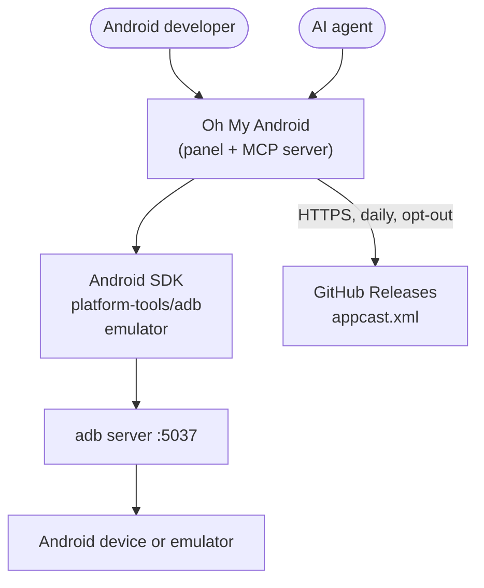

# 01 — C4 context

## Actors and systems

| Element | Type | Relationship |
|---|---|---|
| Android developer | person | Uses the floating panel while testing an app |
| AI agent (Claude Code, Codex, Cursor, Claude Desktop) | external system | Talks MCP JSON-RPC over stdio to `ohmyandroid-mcp` (`Sources/MCP/main.swift:33-45`) |
| Oh My Android | software system | Menu-bar app + embedded MCP server |
| Android SDK / `platform-tools` | external system (user-installed) | `adb` is executed per command; never bundled (`Sources/Core/Android/AndroidSDK.swift:3-6`) |
| Android Emulator | external system | Listed/launched (`-list-avds`, `-avd`), and its console reached via `adb emu` (`Sources/Core/Android/EmulatorLauncher.swift:8-27`, `Sources/Core/Android/ADBClient.swift:68-72`) |
| adb server | external system (localhost:5037) | Host protocol consumer; only `host:track-devices` is spoken directly (`Sources/Core/Android/DeviceTracker.swift:96-118`) |
| Android device / emulator image | external system | Executes shell commands via `adbd` |
| GitHub Releases + Sparkle appcast | external system | One HTTPS GET per day for updates (`Sources/App/UpdateController.swift:16-30`, `project.yml:57-61`) |

## Trust boundaries

1. **Host → device**: everything the app sends lands in an Android `sh` as a single string. The only
   defence is quoting at the call site (`Sources/Core/Support.swift:14`).
2. **Device → host**: stdout/stderr are parsed, never executed. Snapshots (PNG, XML, DB copies) are
   treated as untrusted input (`Sources/Core/Android/AppData.swift:82-85` validates WAL magic before
   writing a side file; `Sources/Core/SQLite/SQLiteSnapshot.swift:73-88` disables `ATTACH`).
3. **App → MCP server**: one preference domain, read by both processes
   (`Sources/Core/AgentAccess.swift:35-67`). The server **defaults to full control** when the app has
   never set a value (`:44`).
4. **App/server → network**: no telemetry; the only egress is the Sparkle appcast
   (`SECURITY.md:9-16`).

## External interface inventory

| Interface | Direction | Protocol | Evidence |
|---|---|---|---|
| Panel UI | human | macOS window (borderless `NSPanel`, non-activating when pinned) | `Sources/Windows/FloatingPanel.swift:6-47` |
| Menu bar | human | `MenuBarExtra` | `Sources/App/OhMyAndroidApp.swift:4-17` |
| Design-image drop / "Open with" | human | file drop on panel, `CFBundleDocumentTypes` PNG/JPEG | `Sources/UI/PanelRootView.swift:30`, `project.yml:63-67`, `Sources/App/AppDelegate.swift:49-57` |
| APK drop / picker | human | `NSOpenPanel` with `apk` | `Sources/App/AppDelegate.swift:20-27`, `Sources/Features/AppFeatures.swift:41-52` |
| MCP | agent | JSON-RPC 2.0 over stdio, dual-era (2026-07-28 `_meta`, or 2024-11-05…2025-11-25 `initialize`) | `Sources/MCP/Server/MCPServer.swift:7-9`, `:95-131` |
| adb CLI | outbound | process spawn + argv | `Sources/Core/Shell/ShellRunner.swift:71-113` |
| adb host protocol | outbound | TCP `127.0.0.1:5037`, `%04x` + service name | `Sources/Core/Android/DeviceTracker.swift:96-118` |
| Update feed | outbound | HTTPS GET of `appcast.xml`, EdDSA + Developer ID verified | `project.yml:56-61` |

## Evidence

`project.yml`, `Sources/App/**`, `Sources/Core/AgentAccess.swift`, `Sources/Core/Android/*`,
`Sources/MCP/**`, `SECURITY.md`.

## Open questions

#3 (platform-tools bundling/licensing), #1 (is the MCP server part of the Windows product).