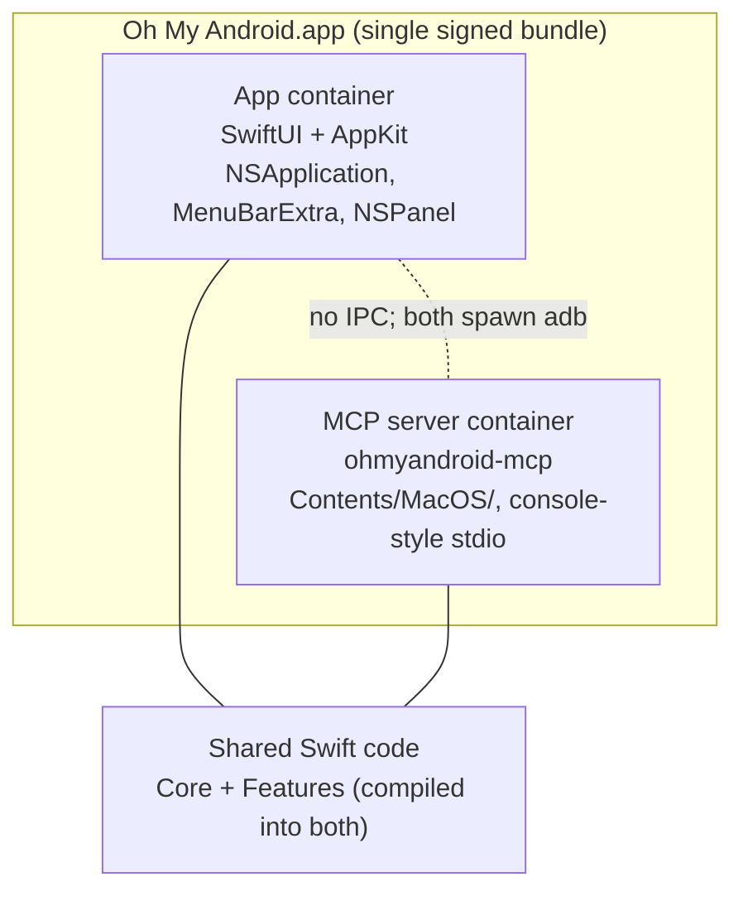

# 02 — Containers

Two deployable containers, one codebase, three XcodeGen targets worth knowing.

| Container | Target | Entry | Process | Talks to | Evidence |
|---|---|---|---|---|---|
| App | `OhMyAndroid` (type `application`) | `Sources/App/OhMyAndroidApp.swift:4`, `Sources/App/AppDelegate.swift:12` | GUI app, `LSUIElement`-style menu-bar + floating panel | `adb`, adb server socket, filesystem, pasteboard, Sparkle | `project.yml:32-81` |
| MCP server | `ohmyandroid-mcp` (type `tool`) | `Sources/MCP/main.swift` | headless console binary, embedded and code-signed with the app | `adb`, shared preferences domain | `project.yml:83-93` |

## Shared code split (compile units, not modules)

Both targets compile the same source directories; there is **no SwiftPM module boundary** between them
(`project.yml:35-36` vs `:86-89`).

| Directory | In app | In MCP server | Note |
|---|---|---|---|
| `Sources/Core` | yes | yes | adb, SDK, shell, SQLite, imaging, policy |
| `Sources/Features` | yes | yes | feature types; `HostActions` defaults are no-ops for the server (`Sources/Features/Feature.swift:25-33`) |
| `Sources/MCP` | **excluded** | yes | `excludes: ["MCP/**"]` (`project.yml:37`) |
| `Sources/App`, `UI`, `Windows`, `State` | yes | no | UI and view models are app-only |
| `Sources/MCP/Protocol/JSONValue.swift` | no | yes | the server's only JSON layer |

Consequences: the MCP server contains the whole feature catalog and can shell out to anything a feature
can. There is no "server-only" reduction of attack surface.

## App container internals (windows)

| Window | Type | Owner | Evidence |
|---|---|---|---|
| Floating panel, 236×700 | `FloatingPanel: NSPanel`, borderless, `.floating` + `canJoinAllSpaces` when pinned, non-activating | `PanelController` | `Sources/Windows/FloatingPanel.swift:6-47`, `Sources/Windows/PanelController.swift:18-27`, `Sources/UI/Theme.swift:5` |
| Data Inspector | `ToolWindow` via `InspectorWindowController`, store `InspectorStore` | `AppDelegate` | `Sources/App/AppDelegate.swift:13-16` |
| Layout Inspector | `ToolWindow` via `LayoutInspectorWindowController`, store `LayoutInspectorStore` | `AppDelegate` | `Sources/App/AppDelegate.swift:14-16` |
| Settings | SwiftUI `Settings` scene, 2 tabs | `OhMyAndroidApp` | `Sources/App/OhMyAndroidApp.swift:13-15`, `Sources/App/SettingsView.swift:8-25` |
| Menu bar item | `MenuBarExtra` with badge dot when an update is pending | `OhMyAndroidApp` + `UpdateController` | `Sources/App/OhMyAndroidApp.swift:8-12`, `Sources/App/UpdateController.swift:42-52`, `:56-78` |

## Deployment container

| Aspect | Reality | Evidence |
|---|---|---|
| Distribution | Signed + notarized zip; Homebrew cask; Sparkle in-app update zip; `.mcpb` bundle of the server alone | `Scripts/release.sh:61-120` |
| Sandbox | Off; hardened runtime on | `project.yml:69-72`, `:16` |
| Login item | `SMAppService.mainApp` | `Sources/App/SettingsView.swift:2`, `:29` |
| Update channel | `https://github.com/ateymoori/oh-my-android/releases/latest/download/appcast.xml`, EdDSA key pinned in Info.plist | `project.yml:56-61` |
| Single instance | Not enforced in code — the app relies on being a normal `.app` (LaunchServices dedupes), and nothing prevents running the MCP server twice | `rg "singleInstance\|NSRunningApplication" Sources` → 0 hits |

## Evidence

`project.yml:26-93`, `Sources/App/AppDelegate.swift`, `Sources/Windows/*.swift`,
`Sources/MCP/main.swift`, `Scripts/release.sh`.

## Open questions

#1 (should Windows ship the MCP server in the same container?).