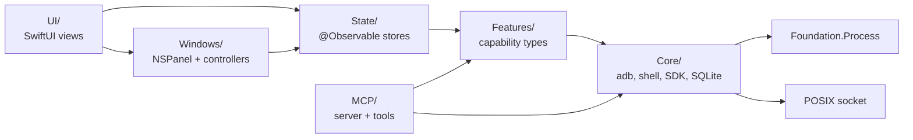

# 03 — Components

Dependency direction is enforced by convention, not the compiler: `UI → State → Features → Core`
(`CONTRIBUTING.md:22-23`). Features import Foundation only; anything AppKit-ish is injected as
`HostActions` closures (`Sources/Features/Feature.swift:25-33`).

## Core

| Component | Responsibility | Entry | Public surface | State it owns | Failure modes |
|---|---|---|---|---|---|
| `ADBClient` (protocol) | The one contract features see | `Sources/Core/Android/ADBClient.swift:4-15` | `devices`, `shell`, `exec-out`, `run`, `emu`, `restartServer`, `screenshot`, batched `shell(sections:)` | none | throws `ShellError` (non-zero exit) / `AppError` (no PNG, KO from console) |
| `AndroidDebugBridge` | Implementation: argv construction, `-s <serial>` targeting, parsing | `:39-121` | as above + `startServer()` | none | bad `devices -l` line → device skipped; non-zero exit → thrown |
| `ProcessShellRunner` | Spawn, drain, timeout, cancel, detached mode | `Sources/Core/Shell/ShellRunner.swift:32-113` | `run`, `runData`, `runDetached`, `Process.detached` | none | 60 s watchdog kills and throws; cancellation sends `SIGTERM`; spawn error rethrown |
| `ADBDeviceTracker` | Hotplug push from the adb server socket | `Sources/Core/Android/DeviceTracker.swift:14-118` | `events() -> AsyncStream<Void>`, `stop()` | socket + retry delay under a `Mutex` | no server → retry with backoff; EOF → restart server and reconnect |
| `AndroidSDK` | Locate `platform-tools/adb` and `emulator/emulator` | `Sources/Core/Android/AndroidSDK.swift:4-36` | `locate()`, `isValid()`, `adb` | none | returns nil; UI shows `.sdkMissing` |
| `DeviceInfoReader` | 9 facts in one shell round-trip | `Sources/Core/Android/DeviceInfo.swift:40-69` | `info(on:adb:)` | none | section count mismatch → `AppError("Unexpected device output.")` |
| `RunAsAppDataReader` | Read prefs/SQLite of debuggable apps | `Sources/Core/Android/AppData.swift:35-92` | `installedApps`, `preferenceFiles`, `preferences`, `databaseFiles`, `pullDatabase` | none (temp dir per pull) | `run-as` denied → empty lists; partial pull deleted (`:79-80`) |
| `UIAutomatorSnapshotReader` | Screenshot + `uiautomator dump` → `UIHierarchy` | `Sources/Core/Android/LayoutSnapshot.swift:82-109` | `snapshot`, `hierarchy` | none | `<100 B` output → retry once after 600 ms, then throw |
| `AccessibilityTraversal` | TalkBack-order approximation + issue detection | `Sources/Core/Android/AccessibilityTraversal.swift:19-115` | `items(in:)` | none | pure; issues attached to items |
| `SQLiteSnapshot` | Read-only SQL over a local DB copy | `Sources/Core/SQLite/SQLiteSnapshot.swift:19-88` | `tables`, `page`, `schema`, `run` | none (open/close per call) | non-readonly statement rejected (`:102-107`); `ATTACH` disabled (`:86`) |
| `ForegroundAppReader` | `dumpsys activity activities \| grep -m1 Resumed` | `Sources/Core/Android/ForegroundAppReader.swift:9-14` | `package(on:adb:)` | none | nil when the regex misses |
| `EmulatorLauncher` | `-list-avds` / `-avd` | `Sources/Core/Android/EmulatorLauncher.swift:6-32` | `avds`, `launch`, `displayName` | none | emulator package missing → `[]` |
| `AgentAccess`/`AgentSettings` | Off / Read / Full policy in the shared preferences domain | `Sources/Core/AgentAccess.swift:4-67` | `access`, `panelDevice`, `recordUse`, `lastUse` | `CFPreferences` keys `agents.*`, `device.lastSerial` | absent key → **full** (`:44`) |

## Features

| Component | Responsibility | Entry | Notes |
|---|---|---|---|
| `Feature` and refinements | `Toggle`, `Stepper`, `Choice`, `Action`, `TextAction`, optional `BatchReadable` | `Sources/Features/Feature.swift:71-172` | each feature is a tiny `Sendable` type with an `id`, icon, category, help |
| `DeviceContext` | Per-action context: device + adb + foreground reader + host actions; `putSetting`, `setDebugProperty`, `foregroundPackage` helpers | `:36-61` | the only thing a feature is given |
| `FeatureCatalog` | Registration and display order; filters emulator-only per device | `Sources/Features/FeatureCatalog.swift:5-85` | "order inside a block is display order" (`:3`) |
| ~50 concrete features | One shell/console string each | `Sources/Features/*Features.swift` | commands table in `06-adb-integration.md` |
| `BatchReader` | One shell call for all `BatchReadable`; per-feature parallel fallback | `Sources/Features/BatchReader.swift:4-34` | sentinel `@@OHMYANDROID@@` |

## State (app only, `@MainActor @Observable`)

| Component | Responsibility | Entry | Failure modes |
|---|---|---|---|
| `AppModel` | Composition root: SDK, adb, stores, host actions, pin/dock prefs, `panelState` | `Sources/State/AppModel.swift:5-96` | any nil dependency degrades to an explicit `PanelState` case |
| `DeviceStore` | Device list, selection, recovery loop | `Sources/State/DeviceStore.swift:9-91` | adb error → `lastError` + empty list |
| `FeatureStore` | Values, busy set, optimistic writes, toasts, staleness | `Sources/State/FeatureStore.swift:14-171` | a second tap while busy is ignored (`:143`) |
| `DeviceInfoStore` | Cached facts with staleness | `Sources/State/DeviceInfoStore.swift` | not read in full (see coverage) |
| `EmulatorStore` | AVD list/start, 180 s start limit | `Sources/State/EmulatorStore.swift:7-60` | exit ≠ 0 before boot → error toast |
| `InspectorStore`, `LayoutInspectorStore` | Inspector view models | `Sources/State/*.swift` | not read in full → open questions #5 |

## MCP

| Component | Responsibility | Entry | Notes |
|---|---|---|---|
| `main` | stdio loop, LF-split, `--version`/`--help`, SIGPIPE ignored | `Sources/MCP/main.swift:19-45` | nothing else may write to stdout |
| `MCPServer` (actor) | Dispatch, dual-era versions, concurrent requests, cancellation, access gate | `Sources/MCP/Server/MCPServer.swift:7-181` | tool errors returned as results (`:145-152`) |
| `MessageWriter` (actor) | One JSON line per message | `:169-181` | write failure → `exit(0)` |
| `Catalog` | 18 tools in 6 groups, 3 prompts, instructions | `Sources/MCP/Server/Catalog.swift:5-60` | stable ordering for cacheability (`:3`) |
| `Tool`, `ToolParameter`, `Arguments`, `ToolResult`, `ToolCall` | Contract + validation + access requirement | `Sources/MCP/Tools/Tool.swift:6-200` | `effect: .read` → `.readOnly`, else `.full` (`:14`) |
| `ToolEnvironment` | SDK/adb resolution per process, device selection, UI-tree cache | `Sources/MCP/Tools/ToolEnvironment.swift:4-112` | no device ready → message listing devices (`:40-50`) |
| `Catalog`/`UITreeText` | Compact agent-facing tree text in dp | `Sources/MCP/Format/UITreeText.swift` | format is a de-facto API; keep byte-compatible |

## Evidence

`Sources/Core/**`, `Sources/Features/**`, `Sources/State/**`, `Sources/MCP/**` (see `docs/coverage.md`).

## Open questions

#4 (per-tool contracts), #5 (inspector stores), #6 (image scaler).