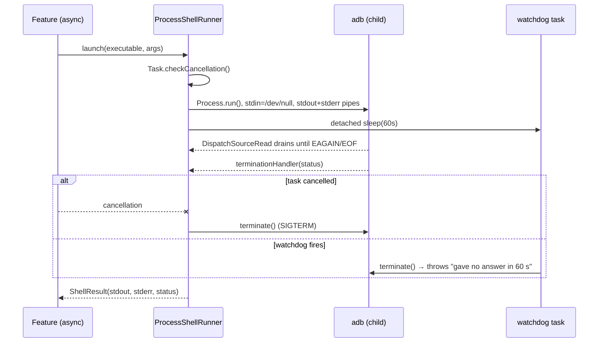
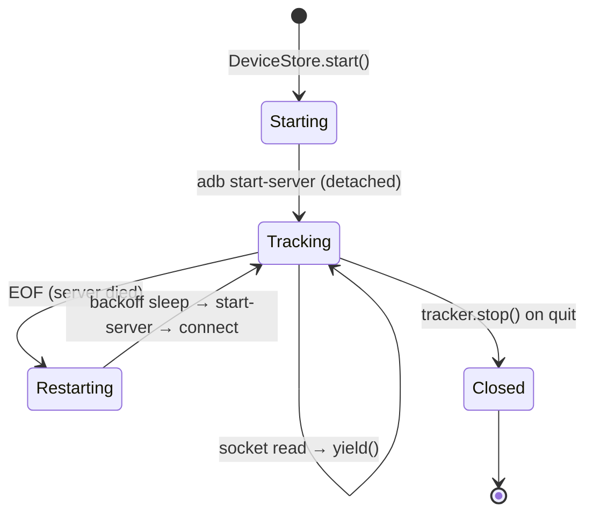

# 05 — Concurrency and lifecycle

Swift 6 strict concurrency, warnings-as-errors (`project.yml:10`, `:20`). Model: `async`/`await` +
structured task groups + `@MainActor @Observable` stores + two `actor`s + one `Mutex`. No locks around
device state (there is none), no background `DispatchQueue` except inside the pipe collector.

## Isolation map

| Code | Isolation | Why |
|---|---|---|
| `AppModel`, `DeviceStore`, `FeatureStore`, `EmulatorStore`, `*InspectorStore`, `PanelController` | `@MainActor` | SwiftUI observation and window geometry |
| `ADBClient`/`AndroidDebugBridge`, `ProcessShellRunner` | nonisolated `Sendable` value types | called from any task |
| `ADBDeviceTracker` | `final class` + `Mutex(State())` (`Sources/Core/Android/DeviceTracker.swift:14-31`) | socket + continuation mutated from a `readabilityHandler` |
| `MCPServer`, `MessageWriter`, `ADBServerStarter`, `HierarchyCache`, `RecorderState` | `actor` | serialized stdout writes, request bookkeeping, one-shot server start |
| `PipeCollector` | `@unchecked Sendable`, serial `DispatchQueue` | reads and the final drain must not race (`Sources/Core/Shell/ShellRunner.swift:136-175`) |

## One command, end to end

Details that matter:

- stdout/stderr are drained **as they arrive** on a non-blocking fd, so a large `uiautomator` dump or a
  `logcat` tail never fills the pipe (`Sources/Core/Shell/ShellRunner.swift:136-175`).
- `finish()` does a final non-blocking drain, because a grandchild (the adb **server**) may still hold
  the write end (`:153-160`).
- Timeout is a `Task.detached` sleeping 60 s; on expiry it returns `true` and the caller throws
  `"<cmd> gave no answer in 60 s."` (`:80-91`, `:108-112`).
- Cancellation of the *calling* task terminates the child (`:98-102`).
- Exit status is checked in one place — `execute` in `ADBClient` — which throws `ShellError` carrying
  stderr-or-stdout (`Sources/Core/Android/ADBClient.swift:88-95`, `Sources/Core/Shell/ShellRunner.swift:13-22`).
- Concurrency is bounded by the caller, not the runner: e.g. `devices()` uses a `TaskGroup` with one
  child per device (`Sources/Core/Android/ADBClient.swift:53-61`), `FeatureStore.readAll` one per
  non-batchable feature (`Sources/State/FeatureStore.swift:59-70`). Nothing throttles these; 8 devices
  = 16 concurrent `adb` processes. `UNVERIFIED` whether that is a practical limit.

## Retries, timeouts, backoff

| Mechanism | Value | Where |
|---|---|---|
| Per-command timeout | 60 s | `Sources/Core/Shell/ShellRunner.swift:33` |
| `emulator -list-avds` timeout | 10 s | `Sources/Core/Android/EmulatorLauncher.swift:12` |
| `uiautomator dump` retry | 1 retry, 600 ms delay | `Sources/Core/Android/LayoutSnapshot.swift:104-107` |
| `restartServer` settle delay | 500 ms after `kill-server` | `Sources/Core/Android/ADBClient.swift:82-86` |
| Device-store restart settle | 1 s | `Sources/State/DeviceStore.swift:68-73` |
| Tracking reconnect backoff | 2 s doubling to 60 s | `Sources/Core/Android/DeviceTracker.swift:22-23`, `:79-94` |
| Boot recovery poll | every 4 s while `selected == nil` or an online device is not booted | `Sources/State/DeviceStore.swift:17`, `:75-90` |
| Emulator start limit | 180 s | `Sources/State/EmulatorStore.swift:14`, `:41-45` |
| Toast lifetime | 2.5 s info / 5 s error | `Sources/State/FeatureStore.swift:125-135` |
| Feature staleness | 5 s | `Sources/State/FeatureStore.swift:27` |
| Recording settle wait | ≤40 × 250 ms while file size is changing | `Sources/Features/CaptureFeatures.swift:88-99` |

**No retry** on a failed adb command other than the two above. A transient `adb` failure surfaces as a
toast and waits for the user.

## Device hotplug / server lifecycle

- The tracking socket is opened by hand: `socket(AF_INET, SOCK_STREAM)`, `SO_NOSIGPIPE` set, `connect` to
  `127.0.0.1:<ANDROID_ADB_SERVER_PORT or 5037>`, then `write("%04x" + "host:track-devices")`
  (`Sources/Core/Android/DeviceTracker.swift:96-118`).
- The stream keeps only the **newest** signal (`.bufferingNewest(1)`), collapsing a boot burst into one
  re-read (`:33-35`).
- On quit, `AppDelegate.applicationWillTerminate` calls `devices.stop()`, which cancels both loops and
  closes the socket (`Sources/App/AppDelegate.swift:39-42`, `Sources/State/DeviceStore.swift:41-46`).
- The adb **server itself is never killed on quit**. Only the user's "Restart adb" does
  `kill-server; sleep 500 ms; start-server` (`Sources/Core/Android/ADBClient.swift:82-86`).

## Startup order

1. `AppModel.init` → `AndroidSDK.locate()` → construct `AndroidDebugBridge`, `DeviceStore`,
   `EmulatorStore` (`Sources/State/AppModel.swift:30-45`).
2. `devices.start { startServer() }` — tracker task begins with `adb start-server` **before** the socket
   (`Sources/State/DeviceStore.swift:29-39`).
3. `AppDelegate.applicationDidFinishLaunching` → inspector controllers → `HostActions` → panel shown
   (`Sources/App/AppDelegate.swift:12-37`).
4. Panel `.task(id: selectedDevice)` → `model.reload()`: device facts + all feature values concurrently
   (`Sources/UI/PanelRootView.swift:32`, `Sources/State/AppModel.swift:82-88`).
5. Panel `.task` → `emulators.reload()` (spawns `emulator -list-avds` once, only at first appearance)
   (`Sources/UI/PanelRootView.swift:33`, `Sources/State/EmulatorStore.swift:20-24`).

MCP server startup is independent and lighter: parse args, locate SDK, create environment, start reading
stdin; `adb start-server` runs lazily once, before the first piped command
(`Sources/MCP/main.swift:29-32`, `Sources/MCP/Tools/ToolEnvironment.swift:20-26`, `:64-72`).

## Shutdown order

App: `devices.stop()` (cancel loops, close socket) → close inspector windows → process exit
(`Sources/App/AppDelegate.swift:39-42`). Spawned `emulator` and the `adb` server keep running by design
(`Sources/Core/Android/EmulatorLauncher.swift:3-6`, `:20-27`); a running screen recording is **not**
stopped on quit — the emulator finishes it whenever it finishes, into a temp path.
MCP server: stdin EOF → wait for every in-flight request (`MCPServer.finish`) → `exit(0)`
(`Sources/MCP/main.swift:43-45`, `Sources/MCP/Server/MCPServer.swift:54-56`).

## Backpressure

- Command output: unbounded in memory; drained continuously so the child never blocks. A pathological
  `logcat` output is bounded only by `| tail -n ≤1000` in the shell pipeline
  (`Sources/MCP/Tools/AppTools.swift:142-143`).
- Device changes: coalesced by `bufferingNewest(1)` (`Sources/Core/Android/DeviceTracker.swift:33-35`).
- Feature reads: a full refresh in flight blocks a second one (`activeRefreshes` guard,
  `Sources/State/FeatureStore.swift:33-42`).
- User actions: one in-flight command per feature; a second tap is dropped
  (`Sources/State/FeatureStore.swift:143`).
- MCP: requests run concurrently with no limit, keyed by JSON-RPC id; cancellation removes and cancels
  the task and suppresses its response (`Sources/MCP/Server/MCPServer.swift:38-84`).

## Evidence

`Sources/Core/Shell/ShellRunner.swift`, `Sources/Core/Android/{ADBClient,DeviceTracker}.swift`,
`Sources/State/{AppModel,DeviceStore,FeatureStore,EmulatorStore}.swift`,
`Sources/MCP/{main.swift,Server/MCPServer.swift,Tools/ToolEnvironment.swift}`,
`Sources/App/AppDelegate.swift`.

## Open questions

None specific. Note the unbounded fan-out (one process per device / per feature) is untested at scale.