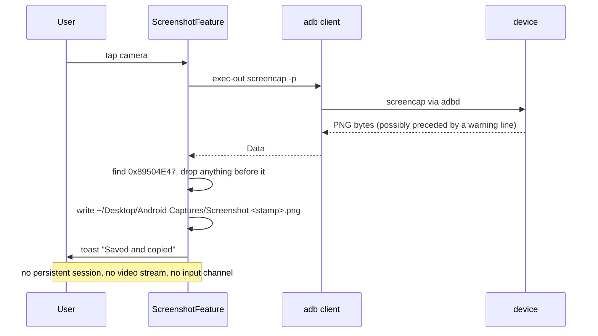

# 07 — Mirroring and device control

## Straight answer: there is no screen mirroring in this repo

No `scrcpy`, no `scrcpy-server.jar`, no `app_process`, no `localabstract` sockets, no H.264, no video
decoder, no control channel, no audio. Verified:

```sh
rg -ni "scrcpy|app_process|localabstract|h264|avc|mediaCodec|video" Sources
# → one hit, the word "mirrored" in an LLM prompt:
#   Sources/MCP/Server/Catalog.swift:40
```

There is also no `screenrecord` path that works on a physical device: recording goes through the
**emulator console** (`adb emu screenrecord …`), which exists only for AVDs.

What the app does instead:

| Capability | Mechanism | Latency | Evidence |
|---|---|---|---|
| See the screen | one `adb exec-out screencap -p` per request; P2 PNG decoded locally | one round-trip (~0.2–1 s, `UNVERIFIED`) | `Sources/Core/Android/ADBClient.swift:21-27` |
| See the UI tree | `uiautomator dump` to `/data/local/tmp`, then `cat` | one round-trip + dump time; retried once if the screen animates | `Sources/Core/Android/LayoutSnapshot.swift:98-109` |
| Interact | `input tap` / `input swipe` / `input keyevent` / `input text` — fire and forget, then an explicit re-read | user-initiated | `Sources/Features/InputFeatures.swift:12`, `Sources/MCP/Tools/InputTools.swift:24-57` |
| Record | emulator console `screenrecord start/stop` → WebM on the Desktop | up to 3 min per clip | `Sources/Features/CaptureFeatures.swift:52-99` |

Consequences that shaped the UI: every screen-level operation is an explicit snapshot, so the Layout
Inspector freezes an image and measures it (`Sources/UI/Layout/LayoutInspectorView.swift:7-51`), and the
MCP instructions tell the model that screenshots are expensive and `get_ui` is cheap
(`Sources/MCP/Server/Catalog.swift:10-16`).



## Where a Windows port actually inherits a problem

The Windows-port meta-prompt assumes "the real decision is mirroring". In this repo the honest
statement is: **there is nothing to port and nothing to lose.** A Windows MVP can reach feature parity
with upstream *without any video path*, by reusing the snapshot + input model. Live mirroring would be
a **new feature**, not a port.

If live mirroring is wanted later, the options are the same as for any adb GUI (bundle `scrcpy.exe` as a
sibling window; embed its client area; or reimplement the scrcpy client protocol). That decision belongs
to `docs/windows-port/02-mirroring-options.md` (Phase 4, not yet written) and is explicitly **out of
scope** for forking this project, because upstream has no code to reuse there.

## Screen recording detail (rare, but a macOS trap worth knowing)

The emulator console **splits arguments on spaces**, so the consumer target path must not contain
spaces, hence a temp file plus a move after `stop` (`Sources/Features/CaptureFeatures.swift:52-58`,
`:70-86`). The container is finalised asynchronously, so the app polls the file size until it stops
growing, for at most 10 s (`:88-99`).

## Evidence

`rg` over `Sources`; `Sources/Features/CaptureFeatures.swift`, `Sources/Core/Android/ADBClient.swift`,
`Sources/Core/Android/LayoutSnapshot.swift`, `Sources/MCP/Server/Catalog.swift:10-16`,
`Sources/UI/Layout/LayoutInspectorView.swift:7-51`, `README.md` (no mirroring claim anywhere).

## Open questions

None. If a live-mirroring feature is desired, it is a **new** ADR, not a port item
(see `docs/windows-port/02-mirroring-options.md`, to be written at Gate 2).