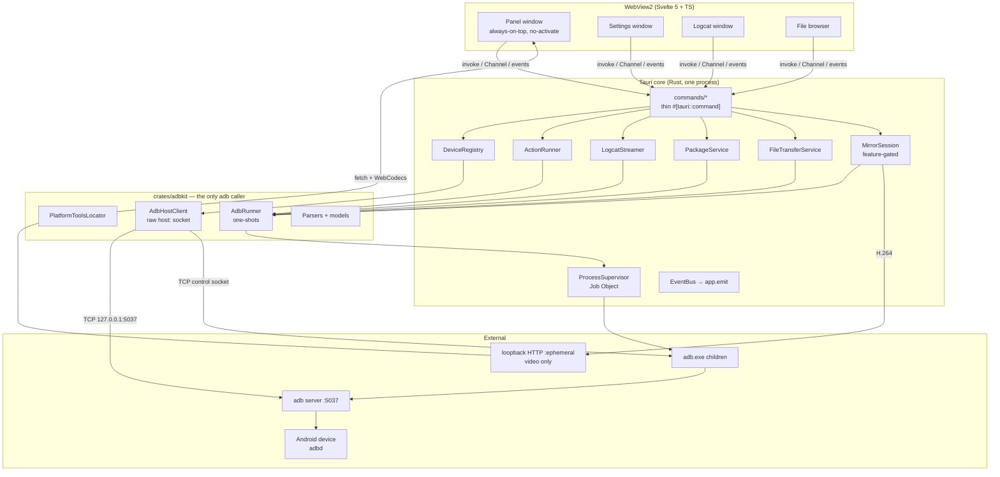

# 11 — Tauri v2 architecture

## 1. Topology



Why this shape: upstream has exactly one adb choke point (`Sources/Core/Android/ADBClient.swift:4-15` +
`Sources/Core/Shell/ShellRunner.swift:32-113`) and one push-based device feed
(`Sources/Core/Android/DeviceTracker.swift:96-118`). Both properties are preserved here, in Rust.

## 2. Cargo workspace

```
Cargo.toml                     # [workspace] members = ["crates/adbkit", "crates/mirror", "src-tauri"]
crates/adbkit/                 # NO tauri dependency. Testable with `cargo test -p adbkit`
  src/lib.rs
  src/locator.rs               # PlatformToolsLocator: SDK discovery + validation
  src/runner.rs                # AdbRunner: spawn adb.exe, one-shot, timeouts
  src/host_client.rs           # AdbHostClient: raw host: protocol, track-devices
  src/model.rs                 # Device, DeviceState, DeviceInfo
  src/parse/mod.rs             # devices_l, getprop, wm_size, df, dumpsys_*, pm_list, install_*
  src/error.rs                 # AdbError (thiserror)
  src/shell_quote.rs           # the ONLY quoting helper
  tests/fixtures/              # recorded transcripts → golden outputs
crates/mirror/                 # feature = "mirror" in src-tauri; empty stub until ADR-0002
  src/protocol.rs              # scrcpy handshake + frame header
  src/session.rs               # MirrorSession trait impl
src-tauri/
  src/main.rs  src/lib.rs
  src/commands/                # thin wrappers: parse args → call core → map error
  src/state/mod.rs             # DeviceRegistry, AppState (ArcSwap/Mutex), SettingsStore
  src/streams/mod.rs           # logcat coalescer, progress coalescer
  src/media/mod.rs             # loopback video server (axum), session tokens
  src/win/mod.rs               # CREATE_NO_WINDOW, Job Object, HWND style helpers
  capabilities/*.json
  resources/platform-tools/    # only if bundling is approved (docs/legal.md §2)
  tauri.conf.json
src/                           # Svelte 5 + TS + Vite
tests/fixtures/                # UI-side fixtures / snapshots
spikes/                        # throwaway, NOT in the workspace
```

Enforced rules (CI checks, `15-plugin-and-security.md` §6):

1. `Command::new(` / `std::process::Command` / `tokio::process::Command` may appear only in
   `crates/adbkit/src/**` and `src-tauri/src/win/**` (the job runner).
2. `crates/adbkit` must not depend on `tauri`, `wry`, or `tao` (`cargo tree -p adbkit` check).
3. No file under `src/` may contain a literal `"adb"` command string — only IPC command names.

## 3. Modules

| Module | Responsibility | Upstream analogue | Notes |
|---|---|---|---|
| `PlatformToolsLocator` | find `adb.exe`: explicit setting → `ANDROID_HOME`/`ANDROID_SDK_ROOT`/`LOCALAPPDATA\Android\Sdk` → `PATH` | `Sources/Core/Android/AndroidSDK.swift:13-36` | must validate by running `adb version` and parsing `1.0.41` |
| `AdbRunner` | one-shot `adb` invocation: argv, explicit `-s`, timeout, cancellation, timeout kill | `Sources/Core/Shell/ShellRunner.swift:56-113` | argv never shell-built; only `adb shell` payload is quoted |
| `AdbHostClient` | raw TCP to `127.0.0.1:5037`, 4-hex length framing, `host:version`, `host:track-devices`, `host:transport` | `Sources/Core/Android/DeviceTracker.swift:96-118` | avoids one process per hotplug event |
| `DeviceRegistry` | authoritative device list + per-device state machine, emits `devices://changed` | `Sources/State/DeviceStore.swift` + `Sources/Core/Android/DeviceTracker.swift` | 8 states, see §6 |
| `ProcessSupervisor` | Job Object per app run; every child assigned; kill-tree on exit/cancel | none upstream (Swift `Process` + `terminate()`) | `CREATE_NO_WINDOW` on every spawn |
| `ActionRunner` | serialized mutating actions with busy/confirm semantics | `Sources/State/FeatureStore.swift` | one mutating action per device at a time |
| `LogcatStreamer` | `logcat -v threadtime` → bounded channel → coalesced batches | none upstream (no logcat UI) | new feature; biggest streaming risk |
| `PackageService` | `pm list packages`, install (argv), uninstall, clear, reset-permissions | `Sources/Core/Android/AppData.swift`, `Sources/Features/AppFeatures.swift` | install progress requires `install-multi-package`/`-S` streaming; `SPIKE` |
| `FileTransferService` | `ls`, `push`, `pull` with progress | none upstream | parse `adb push` stderr progress; `UNVERIFIED` format stability |
| `MirrorSession` | see `13-mirroring-design.md` | none | behind `feature = "mirror"` |
| `SettingsStore` | JSON settings file in `%APPDATA%`, schema-versioned | `Sources/App/SettingsView.swift` + `CFPreferences` keys | do **not** copy upstream's `agents.access` default (`docs/architecture/04-data-and-state.md`) |
| `EventBus` | typed events → `app.emit` / `Channel` | `@Observable` stores | one place that knows IPC |

## 4. Threading model

- Runtime: `tauri::async_runtime` (tokio multi-thread). One supervisor task per device session in a
  `JoinSet`, each holding a `CancellationToken`.
- **Never** block the main thread: no `std::process::Command::output()` on the UI thread, no synchronous
  file IO in a command handler.
- Blocking work (`std::fs`, `std::process` spawn) goes through `spawn_blocking`; `tokio::process` is used
  for streamed children.
- Channels: `tokio::sync::mpsc` with capacity 1024 for lines, 8 for video frames; **drop-oldest** for
  logcat (a log viewer may lose lines, the UI may not stall).
- Coalescing: logcat batches flushed every **33 ms** or **200 lines**, whichever first; progress events
  every **100 ms**.
- Cancellation: `CancellationToken` per action; on cancel → `Job Object` terminate → emit
  `action://cancelled`. Guarantee: child gone ≤1 s (`00-target-and-constraints.md` §3).
- Shutdown: `RunEvent::ExitRequested` → cancel all tokens → terminate job → close host socket → exit.
  Upstream's ordering reference: `docs/architecture/05-concurrency-and-lifecycle.md`.

## 5. Windows process rules

| Rule | Implementation | Why it matters |
|---|---|---|
| No console flash | `creation_flags(0x0800_0000 /*CREATE_NO_WINDOW*/)` on **every** spawn | upstream's detached `start-server` exists for the same class of bug (`ADBClient.swift:43-47`) |
| No orphans | `CreateJobObjectW` + `JOBOBJECT_EXTENDED_LIMIT_INFORMATION.LimitFlags = KILL_ON_JOB_CLOSE`, `AssignProcessToJobObject` on every child | `child.kill()` leaves `adb.exe` servers and `adb shell` trees alive |
| Assignment race | assign immediately after spawn; if `SPIKE S4` shows a grandchild escapes, switch to `CREATE_SUSPENDED` → assign → `ResumeThread` | unsolved without measurement |
| adb server autostart | the first `adb` call spawns a daemon; never `kill-server` implicitly | upstream only restarts the server on explicit user action (`ADBClient.swift:82-86`) |
| CRLF | strip `\r` before parsing/comparing any `adb shell` line | upstream's parsers assume `\n` |
| Encoding | decode stdout lossily as UTF-8 (`String::from_utf8_lossy`); OEM codepage bytes must never panic | device `getprop` can emit non-UTF-8 |
| Paths | always quote; `C:\Program Files (x86)\…` is the normal case | `adb.exe` lives there |
| Long paths | use `\\?\`-prefixed paths for local file ops when >260 chars | push/pull of deep trees |
| stdin | close stdin for one-shots; keep it open only for `adb shell` with a PTY | a piped client can keep the daemon attached — upstream's known bug class |

## 6. Device state machine (UI contract)

Mirrors upstream's eight `PanelState` cases (`Sources/State/AppModel.swift:47-70`), which is the best idea
in the codebase:

`AdbMissing · AdbBroken · NoDevices · Unauthorized · Offline · Booting · EmulatorStarting · Ready`

Rules: state is per-device; no panel region may render data from a different serial; every state has a
primary action and an explanation string; transitions are driven only by `DeviceRegistry`.

## 7. State ownership

| State | Owner | Sync contract |
|---|---|---|
| Device list, per-device state, device info | Rust `DeviceRegistry` | `devices://changed` event (full snapshot, ≤50 devices) |
| Selected serial | Rust (persisted) | command `set_active_device`; event echoes |
| Settings | Rust `SettingsStore` (file) | `settings://changed` |
| UI-only state (open tab, scroll, filter text) | Frontend | never persisted except via `window-state` plugin |
| Logcat buffer | Frontend ring buffer (cap 50 k lines) + Rust stream | Channel batches |
| Busy/error per feature | Rust `ActionRunner` → event | `action://state` |
| Mirror frames | Rust → loopback HTTP → frontend decoder | not IPC |

Rationale: Rust owns anything that must survive a reload or that another window must agree with.

## 8. Startup / shutdown sequence

```
start → single-instance check → load settings → locate platform-tools
      → (verify adb version) → spawn DeviceRegistry listener (host:track-devices, reconnect w/ backoff)
      → show panel (immediately, in AdbMissing/NoDevices state while the above completes)
      → app.emit devices://changed
exit  → cancel tokens → kill job → close :5037 socket → flush settings → exit
```

The panel must paint **before** adb discovery finishes (budget 1.5 s cold start,
`00-target-and-constraints.md` §3); upstream's panel also renders states while loading
(`Sources/UI/PanelRootView.swift`).